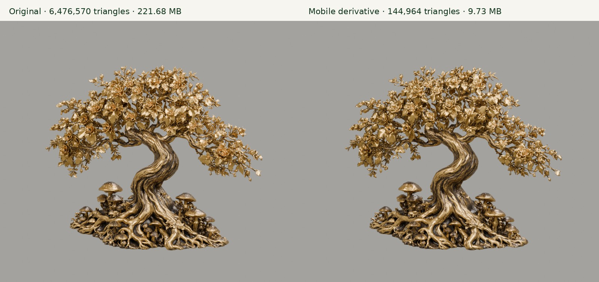

# Mother Nature AR V3 — supplied Meshy tree

This revision is based on `main` at `60f4172` (PR #99). It replaces only the AR actor and adds petal rain; MindAR pose tracking, camera consent, Exit, local recording, Save and Share remain in the existing pipeline.

## Optimized model

| | Source | Mobile derivative |
|---|---:|---:|
| File size | 221,681,036 bytes (221.68 MB) | **9,734,696 bytes (9.73 MB / 9.28 MiB)** |
| Triangles | 6,476,570 | **144,964** |
| Meshes / materials | 1 / 1 | 1 / 1 |
| Base color | 4096² JPEG | 2048² JPEG |
| Metallic/roughness | 2048² JPEG | 1024² JPEG |
| Normal map | 4096² JPEG | 2048² JPEG |

Production asset: `public/ar/models/mother-nature-golden-tree.glb`. It is a standalone GLB with embedded textures, UVs, normals, and the source metallic/roughness material. No Draco/KTX/meshopt runtime decoder, CDN, or external texture URL is required. The original 221 MB source remains outside Git and public files, at `/workspace/ar-model-source/golden-tree-original.glb` in the working environment.



The comparison uses the same camera, lights and render settings. Geometry reduction preserves the recognizable trunk, broad canopy, flowers, mushrooms and exposed roots. Fine geometry/texture detail is softened by aggressive simplification and texture downsampling; this is a mobile derivative, not a lossless archival model. The full source geometry was not selectively segmented or rigged, and no model features were intentionally removed. Final art-direction acceptance belongs to the artist.

`mother-nature-golden-tree.json` stores source/derivative hashes, bytes, triangle count and texture dimensions. `scripts/check-ar-model.mjs` verifies the embedded/self-contained structure, PBR maps, normals/UVs, mobile budgets and integrity on every build / `test:ar` run.

## Reproduce optimization

Use an isolated development folder; no new runtime dependencies are required in this repository. Tested tool versions: glTF Transform core/functions **4.5.1**, meshoptimizer **1.3.0**, sharp **0.35.5**, Node 24. Copy `tools/ar/optimize-golden-tree.mjs` into that folder so its ESM imports resolve against the isolated packages:

```sh
mkdir -p /tmp/tree-optimization
npm install --prefix /tmp/tree-optimization @gltf-transform/core@4.5.1 \
  @gltf-transform/functions@4.5.1 meshoptimizer@1.3.0 sharp@0.35.5
cp tools/ar/optimize-golden-tree.mjs /tmp/tree-optimization/
node --max-old-space-size=6000 /tmp/tree-optimization/optimize-golden-tree.mjs \
  /path/to/private-original.glb /tmp/golden-tree-mobile.glb
```

The pipeline welds, applies attribute-aware meshoptimizer simplification with a 145,000 / 6,476,570 target ratio and 0.008 error threshold, then prunes unused resources. It resizes the three original JPEGs with 4:4:4 chroma, quality 90/94/94, keeping all three PBR maps. It does not repaint gold, rebake artwork, recompute the material or introduce guessed geometry. Regenerate/verify the derivative metadata when deliberately changing the model. Do not add the original to Git.

## Runtime / tuning

- `src/ar/customTree.ts`: self-hosted, abortable GLB fetch and Three GLTFLoader parse; 15 MB safety guard and 30-second timeout. The procedural tree is immediately available while loading and remains on failure. Late results after exit are disposed rather than attached. CPU geometries/materials, textures and ImageBitmaps are released on replacement/exit.
- The imported tree is uniformly normalized to **1.5 target widths high**, approximately **1.81×** the prior 0.83-high tree. Roots start near `(0, -0.55, 0.34)` in tracked-image coordinates. Its wide canopy deliberately extends beyond the image. Stand farther back to see the whole sculpture; close views may naturally crop the canopy at the phone viewport.
- Reveal is a subtle 1.8-second rise/scale, with slow 0.12 rad/s rotation. Reduced motion shows a static tree without decorative reveal/rotation.
- `src/ar/petalRain.ts`: **64** independently phased falling/fluttering petals, one instanced draw call, shared small curved geometry/material, varied speed/scale/position. Rain surrounds the tree and is hidden under reduced motion. The older seven-petal effect is suppressed in the fallback to avoid doubled rain.
- `src/ar/engine.ts`: swaps the actor only, preserving image pose smoothing and synchronous post-render recording hook. The root anchor still disappears on tracking loss. Renderer DPR is capped at 1.25, multisample antialiasing is disabled, and rendering is capped at 30fps to leave budget for tracking/recording. These are configuration limits, not measured device FPS. Fine silhouette edges trade some antialiasing for lower fill/memory cost; The existing small environment map supplies metallic reflections. Rendering pauses while the full-screen clip review or native recording-help panel is open; camera/image tracking continues and rendering resumes on return.
- `camera.ts` / `camera.css`: brief loading/fallback notice; no changes to size, pricing, storefront or certificate data.

## Preserve entry pages versus image-target provenance

**Do not merge `entryPaths` into `certificatePaths`.** `src/ar/experiences.json` is unchanged from PR #99:

- `entryPaths`: both Mother Nature Original and Collector’s Edition can launch this same AR experience.
- `certificatePaths`: only the verified Original front supplies target provenance. The Collector’s Edition is an entry point, not a newly verified target.

The other 13 certificates, permanent QR paths, certificate records and photographs are unchanged. An image on a different certificate front is not promised to track merely because its page can launch AR. Visitors are shown the same verified image preview.

## Verification and hardware limits

Run `npm test`, `npm run build`, `npm run test:seo`, `npm run test:coa`, `npm run test:ar`. New unit tests cover uniform root-to-canopy scaling, original-material preservation, fallback/replacement, failed loads, late completion after exit, texture/geometry disposal, and instanced/reduced-motion rain. The existing recording test’s overloaded canvas mock is adapted to the GPU canvas type declarations pulled in by GLTFLoader; recording behavior itself is unchanged.

The production-output integration script (`scripts/check-ar-browser.py`) additionally waits for the real imported model before testing a composited recording. It uses Chromium with a private synthetic camera feed of the authentic target and is **not** a physical Safari performance benchmark. See [Phase B recording/browser limitations](../certificate-ar-phase-b.md). Test on an actual iPhone 15 before production approval:

1. Open each Mother Nature entry page over HTTPS; Start camera; observe loading then the textured tree.
2. Check trunk, flowers, mushroom caps, exposed roots, canopy framing, gold finish and 64-petal density. Move back, pan and tilt; briefly obscure the image and reacquire.
3. Record a 10–15-second clip; verify camera **and custom model/rain** in the decoded saved/shared file, correct orientation, and acceptable frame rate. Confirm native recording fallback remains usable.
4. Exit/background during loading and recording; camera indicator must turn off. Test a failed GLB request and ensure the original procedural actor remains functional.
5. Check reduced motion and thermal/memory behavior on device. No physical iPhone FPS, Safari recording performance or field tracking stability is asserted from software-rendered tests.

No merge or production deployment without artist approval.

## Recorded review results

- All **156 tests across 28 files** passed after rerunning without competing render workloads; production build/typecheck, SEO, 15 COA records and model/target integrity passed. The initial concurrent run hit an existing Studio Print test timeout; no storefront test or product behavior was changed to hide it.
- The real imported GLB rendered with its textures against the authentic image target in production-output Chromium. A farther-back synthetic feed produced a decoded **12.134-second H.264/MP4** with the custom sculpture and petal rain. The strengthened integration script compares a decoded recorded frame with the raw static camera image and requires a visible overlay difference; it passed the capture/save/gesture-share/exit stage.
- Forced GLB 404 through the Collector’s Edition entry verified procedural fallback, usable Record, and return to the same Collector’s Edition certificate. This test uses the verified Original artwork image as the camera target; it does not claim a newly verified Collector’s Edition front.
- Geometry/material/texture and ImageBitmap cleanup is asserted in unit tests, including a model that finishes loading after exit. No new certificate source was compiled.
- Close-up software rendering was heavy and had intermittent tracking loss. The farther-back view reduces screen coverage and frames the full canopy. Renderer limits and panel pausing reduce work, but **actual iPhone 15 thermal behavior, tracking stability and saved-video quality still require physical testing**. Automated file sharing is a plumbing simulation, not an iOS share-sheet test.
- Private run evidence lives in `/workspace/previews/ar-v3/`; only the standalone optimized model and the studio comparison are published in this draft.
