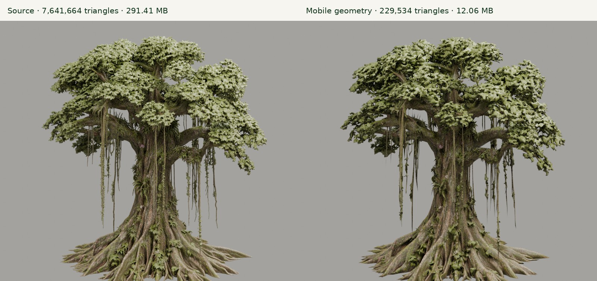

# Ancient Rainforest — isolated AR prototype

## Scope and review route

Open `/rainforest-ar.html` on the **Netlify deploy preview** or local development build. This is a separate noindex experiment using Mother Nature's already verified image target. It is not linked from any certificate, storefront, navigation, sitemap or production QR destination. The current golden-tree experience and its Original/Collector’s Edition entry paths remain unchanged.

Production builds (`CONTEXT=production`) omit the experimental HTML input and alias the scene module to a disabled stub. This prevents the model, decoder/lab chunks and styles from entering the production module graph. Verify this with `node scripts/check-rainforest.mjs --production` against a completed production build. No production deployment or merge is authorized by this prototype.

## Asset inspection and optimization

| | Original | Prototype |
|---|---:|---:|
| Download | 291,408,684 bytes | **12,058,396 bytes (12.06 MB)** |
| Triangles | 7,641,664 | **229,534** |
| Geometry / materials | one combined mesh / one PBR material | same |
| Base colour | 4096² JPEG | 2048² JPEG, quality 92, 4:4:4 |
| Metallic/roughness | 2048² PNG | 1024² lossless PNG |
| Normal | 4096² PNG | 2048² lossless PNG |
| Estimated RGBA texture storage, with full mipmaps | ~192 MiB | ~48 MiB |

Source dimensions: X 1.878506, Y 1.920688, Z 1.518787 model units. The single root node has an identity transform; Y is the vertical axis. Original positions, normals, UVs and all three material maps are present. No authored animations, skin hierarchy or separate vine/leaf objects are available in this combined mesh. No parts are individually rigged or replaced.

The source ZIP (219,936,773 bytes) and extracted original are private, outside Git at `/workspace/rainforest-source/`. The source GLB SHA256 is `c26d612c67b7291bf37ee175045997f27a475bb6f2ac930a1c119d38c97aa357`. Drive sharing permissions were not changed. The original 291 MB file is never publicly served or committed.

The optimizer welds, simplifies with attribute-aware meshoptimizer (requested 200k triangles, error bound 0.004) and prunes unused resources. It stops at 229,534 rather than sacrificing more vines/silhouette to hit a number. Texture downsampling reduces bandwidth and decoded texture memory. Meshopt high compression then quantizes position to 14 bits, normals to 12 and UVs to 14, using `EXT_meshopt_compression` / `KHR_mesh_quantization`. Three.js's bundled self-hosted decoder is configured **only for this scene**; the exact bundled decoder successfully decodes every compressed buffer. No new runtime package, paid service or remote decoder is used. The Meshoptimizer MIT notice is retained in `public/ar/vendor/MESHOPT-LICENSE.txt`.

The standalone optimized asset is `src/ar/experimental/assets/ancient-rainforest.glb`; its `?url` import emits a hashed deploy-preview download. Metadata and integrity/budget checks live beside it and in `scripts/check-rainforest.mjs`. No other models, petal rain, birds, mist, mushrooms, extra flowers, growth reveal or automatic spin are instantiated.



The studio comparison shows the original and the mobile geometry/texture stage immediately before Meshopt serialization. Quantization is evaluated separately in the actual decoded browser render. Simplification and downsampling soften some small foliage and bark details; they are not lossless. Roots, major branching, hanging vines and the canopy outline are prioritized over sub-pixel detail. Texture memory estimates exclude CPU image copies, geometry, decoder scratch buffers, tracking tensors and driver overhead; they are not GPU measurements.

### Reproduce

Use the same isolated tools as the golden-tree optimization: `@gltf-transform/core`, `functions` and `extensions` 4.5.1, meshoptimizer 1.3.0, sharp 0.35.5, Node 24. Copy `tools/ar/optimize-rainforest.mjs` into an isolated folder with those packages and run:

```sh
node --max-old-space-size=6500 /tmp/tree-optimization/optimize-rainforest.mjs \
  /private/path/original.glb /tmp/rainforest-mobile.glb
```

Run `npm run test:ar:rainforest` to validate the committed GLB, hash, PBR structure, geometry budget and compatibility with the **bundled Three decoder**, not merely the newer optimization tool. Regenerate metadata deliberately when changing the derivative.

## Placement and lighting

The whole tree appears immediately once loaded. A shared +90° X pivot maps its local Y trunk to the tracked image's outward Z normal. Bounds normalization plants the lowest root at image-plane height zero. There is no camera-facing rotation, world tracking, plane detection or gravity estimator. The tree stays in the existing MindAR image anchor and hides on target loss.

Default height is **3 target widths**, root X 0 / Y -0.55, manual yaw 0. The lab sliders change height, X/Y position **on the artwork plane**, and manual trunk angle without rebuilding the GLB. A render pixel-ratio control (0.5–1.25, default 1.0 for this lab) lets the device reviewer trade sharpness for fill-rate cost. It does not reduce mesh triangles or texture storage. Its value is copied into diagnostics. Roots cannot be moved above/below the image plane through those controls. Reset restores the default. The huge canopy may clip at close range; move farther back and view the flat artwork obliquely to see trunk height. The mesh, texture colours, normals and material are unaltered at runtime. Neutral hemisphere/directional lighting and the existing small studio reflection environment are used only for this scene. No jungle background or effects are added.

## Metrics, recording and limitations

Open **Rainforest lab · controls & metrics** after starting the camera. The panel records at most 180 recent one-second samples, entirely in memory. **Copy diagnostics** copies JSON only—no images or video, and no uploads. Saved JSON includes placement, browser user agent, loading times, recording state and timestamps.

- Load: download bytes/time, Meshopt decode + glTF/image parse time, total model-ready time, and first tracked render-submission time. These are wall-clock software measurements, not a network throughput guarantee or exact GPU-present time.
- Frames: submitted render FPS, p50/p95 frame intervals, and p95 CPU time around renderer/capture submission. They include rendering/camera/tracker contention; they do not measure GPU execution time. Deliberate full-screen review/help pauses are excluded from frame intervals.
- Tracking: found/lost transitions, update count, age of latest valid pose, and mean pose step in target-width units. Pose steps contain actual phone movement; they are **not isolated jitter measurements**. Use a stationary phone/card and compare near/far/occlusion runs to assess stability.
- Memory: geometry/texture object counts and JS heap bytes where the browser provides Chromium's nonstandard API. Safari generally has no JS heap counter; `null` means unavailable, not zero memory. No actual GPU-byte reading is available. WebGL loss or load errors stop the session with a usable exit and the last lab report.
- Recording reuses the existing local camera + transparent Three-canvas composition and 12-second preview/save/share flow. The lab requests **30fps canvas capture**; the golden-tree path keeps its existing 24fps recording settings. Render target is nominally 30fps for the lab with existing DPR 1.25. Encoding, backgrounding and CPU readback can lower actual FPS. The lab marks samples taken while recording. Where supported, the 30fps experimental path requests a canvas frame explicitly after each composition; the existing 24fps golden-tree path is unchanged. Native screen-recording guidance remains available when browser capture fails. A finite clip shorter than eight seconds after the automatic 12-second capture (or shorter than half a second even after manual Stop) is marked unusable and routed to native guidance instead of being presented as a successful recording. Deliberately stopped shorter clips are otherwise allowed. Infinite/unknown metadata duration is not assumed to prove a valid clip; always inspect the preview.

**30fps on iPhone 15 has not been demonstrated by desktop simulation.** A 229k-triangle, double-sided textured canopy and ~48 MiB texture estimate may still stress mobile fill rate, texture memory, tracking compute and recording readback. Repeated relaunches, warm-cache behavior and thermal throttling need hardware review. The renderer/context and model textures are disposed on exit, including late completion after cancellation. The entire source tree may naturally include moss/epiphytes authored in the supplied combined asset; no new companion models are added.

## iPhone Safari protocol

1. Open the HTTPS **preview** `/rainforest-ar.html` in Safari on iPhone 15. Tap Start camera and grant permission. Point at the verified Mother Nature artwork image shown in the instructions, not the QR. Use the image on another screen or printed card; the prototype does not add a new certificate target.
2. Let the full tree load; note cold download/parse and first tracked-render times. Keep the artwork flat and move the phone to an oblique angle. Verify roots contact the surface, vines and branches have depth, and there is no spin/reveal. Try the placement sliders and reset.
3. Record diagnostics during 30 seconds of normal operation: stationary phone/card, slow pan/tilt, near/far, brief occlusion and reacquisition. Look for drifting, lag, shimmer or WebGL loss. Repeat at smaller and larger tree sizes; changing scale does not lower triangle count but changes pixel coverage.
4. Record a 12-second AR clip. Check diagnostics samples marked recording, the decoded saved file's camera + rainforest composition and orientation, and native Save/Share on the real device. Compare frame rate with normal mode; target at least 30 if feasible, without claiming success from configuration alone.
5. Repeat after several minutes for thermal behavior; background/resume, deny permission, reopen, exit while loading/recording, and verify the camera indicator stops. Copy the report for each run before exiting. No automatic diagnostics or video upload occurs.

## Checks

`npm test`, `npm run build`, `npm run test:seo`, `npm run test:coa`, `npm run test:ar`, `npm run test:ar:rainforest`.

Production isolation check:

```sh
CONTEXT=production BRANCH=main npm run build
node scripts/check-rainforest.mjs --production
# Restore the lab preview build before local browser testing:
npm run build
```

Existing certificate/QR manifests, golden-tree GLB, entry configuration and storefront data are unchanged. A draft PR and deploy preview are review artifacts only; do not merge or deploy production without approval.

## Initial desktop measurements — not iPhone results

The initial headless Chromium/SwiftShader run used a synthetic, static, obliquely projected authentic certificate image and the default height of three target widths. Before the quality control was added, DPR was 1.25. Model fetch took 3,448 ms, decode/parse 611 ms, ready 4,060 ms and first tracked submission 4,538 ms on the local test server. These are local-environment observations, not Internet/iPhone timings.

- 52 samples: normal median submitted FPS **0.72** (46 samples); recording median **0.61** (6 samples). Normal/recording p95 frame intervals reached about **6.6 / 6.1 seconds**. This does **not** meet the 30fps target on the software renderer.
- The diagnostic snapshot reported one geometry, four textures including the environment, and ~19.96 MB JS heap; this excludes real GPU/decoder/camera memory. No tracking-loss transition was reported in that static run; mean pose step was ~0.021 target widths and cannot be treated as physical tracking stability.
- The browser encoder initially produced a **0.033-second single-frame MP4**, so that was not a usable AR recording despite data being returned. The experimental guard now reports this condition and offers native recording guidance. We do not count API presence or a nonempty file as successful video capture.
- GLB decoding/rendering, manual placement controls, local diagnostic copy, scripted share plumbing and camera shutdown were exercised. Share plumbing was mocked; it is not native iOS-share validation. Original-screen/flyer tracking on the golden tree does not establish this model’s performance.

The quality-0.5 follow-up produced a decoded **10.081833-second, 75,287-byte H.264/MP4** containing the camera image and tree. Submitted normal/recording median FPS were still only **0.76 / 1.42** in this software environment. Placement/reset, local diagnostic copy, save, simulated gesture-share plumbing and camera shutdown passed; there were no page errors or golden-model requests. Render FPS and the container’s nominal video-frame metadata are different measurements. The physical iPhone protocol above is the next comparison. Lowering quality may help fill rate but cannot prove 30fps on an actual iPhone. Keep this as a draft performance/visual prototype until hardware diagnostics and recorded footage have been reviewed. Private browser reports/screenshots remain under `/workspace/previews/rainforest/`; no source certificate or test video is published.

Final validation: **161 tests / 29 files**, production build exclusion, deploy-preview build, SEO, all 15 COA records and both model-integrity checks passed. The 30fps iPhone target remains unverified; this is a performance/visual prototype, not a production-performance approval.
